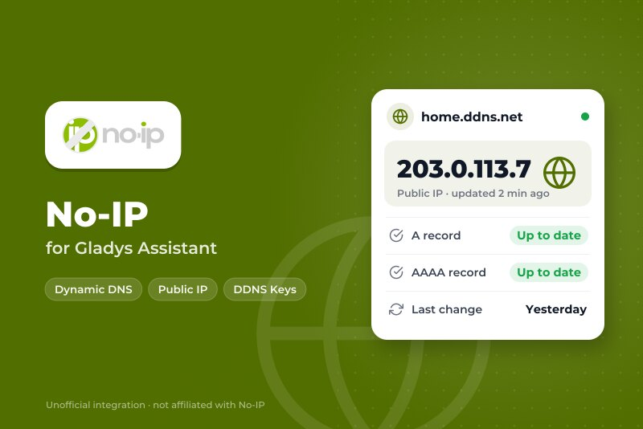
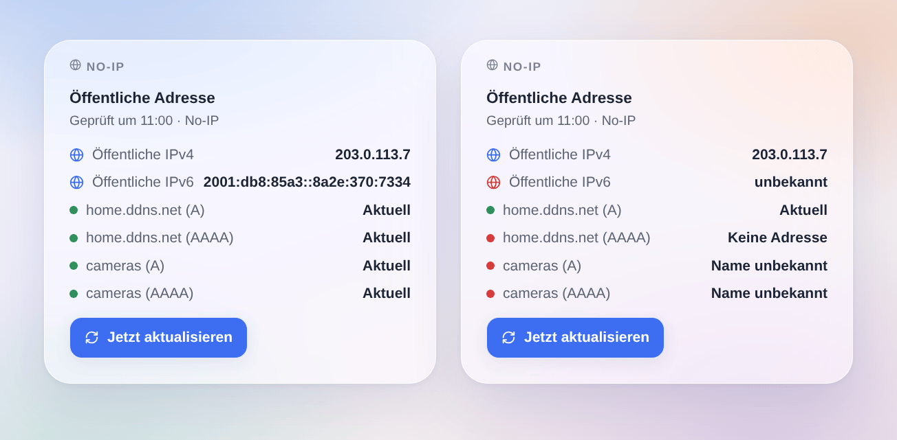
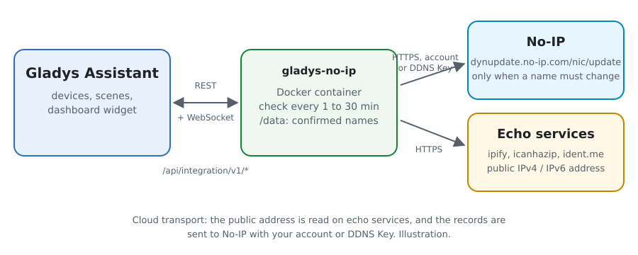
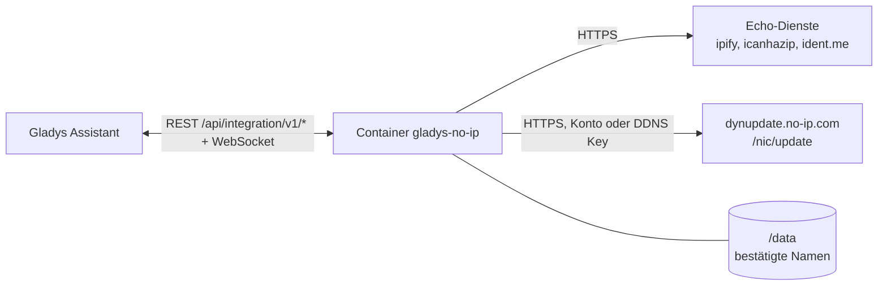
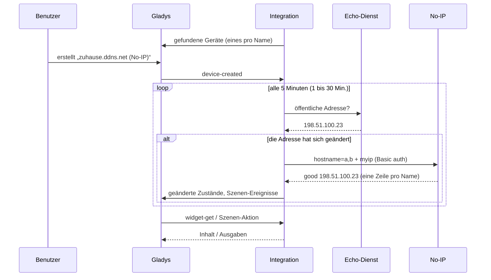

# Gladys No-IP

[English](README.md) · [Français](README.fr.md) · **Deutsch** · [Español](README.es.md)

[](LICENSE)
[](https://github.com/William-De71/gladys-no-ip/releases)
[](https://github.com/William-De71/gladys-no-ip/actions/workflows/release.yml)
[](https://gladysassistant.com)



Externe Integration für [Gladys Assistant](https://gladysassistant.com): **dynamisches DNS mit [No-IP](https://www.noip.com)**. Gladys hält deine No-IP-Hostnamen (`zuhause.ddns.net`), Gruppen oder DDNS Keys über den offiziellen Aktualisierungsendpunkt von No-IP auf die öffentliche IPv4- / IPv6-Adresse deines Zuhauses gerichtet. Jeder Name wird ein Gerät, und Szenen können reagieren, wenn sich die öffentliche Adresse ändert oder eine Aktualisierung fehlschlägt.

Benutzerdokumentation: [English](docs/en.md) · [Français](docs/fr.md) · [Deutsch](docs/de.md) · [Español](docs/es.md).

> Community-Integration, nicht mit No-IP verbunden und nicht von No-IP unterstützt.

## Funktionen

- **Bis zu zehn Namen** in einem Feld: Hostnamen, No-IP-Gruppen oder `all.ddnskey.com` für alle Hostnamen eines DDNS Keys; IPv4 (A), IPv6 (AAAA) oder beide, zusammen in einer Anfrage gesendet.
- **Ein Gerät pro Name**: von No-IP bestätigte IPv4- und IPv6-Adressen, Status in Worten, Zahl der Adressänderungen.
- **3 Szenen-Auslöser**: öffentliche Adresse geändert, Eintrag aktualisiert, Aktualisierung fehlgeschlagen (einmal pro Fehler).
- **2 Szenen-Aktionen**: jetzt aktualisieren (ein Name oder alle, optional erzwungen), öffentliche Adresse lesen.
- **1 Dashboard-Widget**: die öffentliche Adresse und jeder Name mit seinem Status, und ein Knopf **Jetzt aktualisieren**.
- **Konfigurationsknöpfe**: Verbindung testen (jeder Name sofort gesendet), Diagnose.
- Hält sich an die Client-Regeln von No-IP: Ein Name wird nur gesendet, wenn sich seine Adresse ändern muss, nie zwei Anfragen in einer Minute, jeder Fehler stoppt die Updates bis zu einer Konfigurationsänderung (auch über einen Neustart hinweg), und 30 Minuten nach einer No-IP-Störung wird nichts gesendet. Vier Sprachen (Englisch, Französisch, Deutsch, Spanisch).



## Funktionsweise





Bei jeder Prüfung (standardmäßig alle 5 Minuten) liest die Integration die öffentliche Adresse bei Echo-Diensten (der nächste, wenn einer ausfällt) und vergleicht sie mit der Adresse, die No-IP zuletzt für jeden Namen bestätigt hat, gespeichert in `/data`. Bei der allerersten Prüfung wird ein Hostname, der bereits auf die öffentliche Adresse zeigt, ohne Aufruf übernommen (Gruppen und DDNS Keys sind keine DNS-Namen: Sie werden einmal gesendet). Die Namen, die sich ändern müssen, gehen in einer Anfrage an `https://dynupdate.no-ip.com/nic/update` (`hostname=a,b&myip=<ipv4>,<ipv6>`); No-IP antwortet eine Zeile pro Name (`good` = geändert, `nochg` = schon aktuell, oder ein Fehler). Ein Hostname, der eine Viertelstunde nach einem Update noch woanders hinzeigt, wird erneut gesendet, höchstens alle 6 Stunden: No-IP sperrt Clients, die zu viele `nochg` sammeln.



### Transport

Nur Cloud (`"transports": ["cloud"]`): Der Katalog zeigt das Cloud-Abzeichen, und es gibt keinen Knopf „lokale Verbindung bevorzugen“. Die Integration kontaktiert die Echo-Dienste `api.ipify.org`, `ipv4.icanhazip.com`, `v4.ident.me` (und ihre IPv6-Zwillinge, wenn IPv6 gefolgt wird), die nur die Adresse deines Zuhauses sehen, und `dynupdate.no-ip.com` mit deiner Anmeldung. Das Passwort bleibt in Gladys und im Container; der Knopf **Diagnose** zeigt nur seine Länge.

## Geräte und Funktionen

| Gerät            | Funktion                    | Kategorie / Typ            | Bereich        |
| ---------------- | --------------------------- | -------------------------- | -------------- |
| `<Name>` (No-IP) | IPv4-Adresse (A-Eintrag)    | `text` / text              | —              |
| `<Name>` (No-IP) | IPv6-Adresse (AAAA-Eintrag) | `text` / text              | —              |
| `<Name>` (No-IP) | No-IP-Status                | `text` / text              | —              |
| `<Name>` (No-IP) | Adressänderungen            | `counter-sensor` / integer | 0 – 10 000 000 |

Externe ID: `host:<Name>`, der Hostname, die Gruppe oder `all.ddnskey.com` in Kleinbuchstaben, egal an welcher Stelle der Liste. Die IPv4- / IPv6-Funktionen gibt es nur, wenn dieser Familie gefolgt wird. `should_poll` ist false: Die Integration prüft mit ihrem eigenen Timer.

## Szenen-Auslöser, Aktionen und Widgets

| Art      | Schlüssel           | Verwendung                                                                                      |
| -------- | ------------------- | ----------------------------------------------------------------------------------------------- |
| Auslöser | `public_ip_changed` | Die öffentliche Adresse hat sich geändert; Filter: IPv4 / IPv6.                                 |
| Auslöser | `record_updated`    | No-IP hat einen Namen auf eine neue Adresse gerichtet; Filter: Gerät des Namens, IPv4 / IPv6.   |
| Auslöser | `update_failed`     | Ein Name konnte nicht aktualisiert werden, einmal pro Fehler; Filter: Gerät des Namens, Fehler. |
| Aktion   | `update_now`        | Jetzt prüfen und aktualisieren; ein Name oder alle, optional erzwungen (einmal pro Stunde).     |
| Aktion   | `get_public_ip`     | Die öffentliche IPv4 und IPv6 und ein Satz.                                                     |
| Widget   | `status`            | Öffentliche Adresse, jeder Name mit seinem Status, **Jetzt aktualisieren**.                     |

Die Variablen der Auslöser liefern den Namen, den Adresstyp, die neue und die vorherige Adresse und bei einem Fehler den Fehlercode und die Meldung. Die erste Prüfung ist eine Referenz: Die bei der Installation gesehene öffentliche Adresse löst nichts aus, und ein Neustart löst nie dieselbe Änderung zweimal aus. Eine Szenen-Aktion löst nie einen Auslöser aus (keine Schleifen) und hebt nie einen Stopp auf; eine von ihr gesehene Änderung löst bei der nächsten Prüfung aus.

Beispiele:

- „Öffentliche Adresse geändert“ → „Neue Adresse: {{triggerEvent.data.ip}}“ an dein Handy senden.
- „Aktualisierung fehlgeschlagen“, Fehler „Anmeldung abgelehnt“ → dich daran erinnern, den DDNS Key zu prüfen.
- Jeden Morgen → „öffentliche Adresse lesen“ → in eine Nachricht schreiben.

## Voraussetzungen

- Gladys Assistant **5.3.0** oder neuer (Widgets, Szenen-Auslöser und -Aktionen externer Integrationen, Katalog-Stichwörter von Gladys 5.3). Ältere Instanzen können die Integration nicht installieren.
- Ein No-IP-Konto mit mindestens einem Hostnamen, am besten ein **DDNS Key** (Dynamic DNS → DDNS Keys). Kostenlose Hostnamen müssen weiterhin alle 30 Tage auf der No-IP-Website bestätigt werden.

## Installation

- **Aus dem Store** von Gladys (Integrationen → Externe Integrationen), mit einem Klick, sobald indexiert.
- **Über die URL des Repositorys**: `https://github.com/William-De71/gladys-no-ip`.
- **Entwicklermodus**: Baue das Image lokal (`docker build -t gladys-no-ip .`) und installiere es aus Gladys.

## Konfiguration

| Feld                             | Beschreibung                                                                                       |
| -------------------------------- | -------------------------------------------------------------------------------------------------- |
| Benutzername                     | Der Benutzername eines DDNS Keys oder die E-Mail-Adresse (oder der Benutzername) des No-IP-Kontos. |
| Passwort                         | Sein Passwort (geheim).                                                                            |
| Hostnamen                        | Durch Kommas getrennt, höchstens zehn: Hostnamen, Gruppen, `all.ddnskey.com` mit einem Key.        |
| Zu aktualisierende Einträge      | IPv4 (A, Standard), IPv6 (AAAA) oder beide.                                                        |
| Prüfung der öffentlichen Adresse | Jede Minute, alle 5 Minuten (Standard), 15 oder 30 Minuten.                                        |
| Sprache der Texte                | Gerätenamen, Status und Szenen-Zusammenfassungen. Automatisch folgt dem Dashboard.                 |

Knöpfe: **Verbindung testen** (sendet sofort jeden Namen an No-IP, hebt einen Stopp auf und zeigt die Antwort pro Name) und **Diagnose** (schreibt die Konfiguration, die öffentlichen Adressen, die bestätigten Namen und die letzten Fehler in den Tab Protokolle, Passwort verborgen).

## Verwendung

1. Erstelle einen DDNS Key auf der No-IP-Website (oder nutze dein Konto), gib seinen Benutzernamen, sein Passwort und deine Hostnamen ein, speichere und drücke **Verbindung testen**.
2. Erstelle im Tab **Entdecken** das Gerät jedes Namens.
3. Füge das Widget **No-IP** einem Dashboard hinzu und baue Szenen mit den obigen Auslösern und Aktionen.

## Entwicklung

```bash
npm install
npm test                       # node --test, berührt nie das Netzwerk
npm run lint && npm run format:check
npx github:GladysAssistant/integration-store . --skip-image-check
scripts/build-cover.sh         # cover.jpg aus docs/assets/cover.svg
docs/illustrations/render.sh   # docs/assets/widgets.<lang>.png
node .github/scripts/release.mjs next
```

Lokal liest das SDK `GLADYS_HOST_API_URL`, `GLADYS_INTEGRATION_TOKEN` und `GLADYS_INTEGRATION_SELECTOR`; `DEBUG=gladys-integration-sdk` zeigt die SDK-Protokolle und prüft jeden Widget-Inhalt. Die Tests nutzen ein falsches Netzwerk, das wie No-IP antwortet (eine Zeile pro Name, `good`, `nochg`, `nohost`, `badauth` mit HTTP 401, `911`, `abuse`…), und einen falschen Resolver. Die Regeln des Projekts stehen in [CLAUDE.md](CLAUDE.md).

## Release-Prozess


Jeder Merge auf `main` startet die CI und berechnet dann die Version aus den [Conventional Commits](https://www.conventionalcommits.org/) seit dem letzten Tag: `feat` → Minor, `fix` / `perf` → Patch, `!` oder `BREAKING CHANGE` → Major (ein Minor unter 1.0.0); `docs`, `chore`, `ci`, `test`, `style`, `refactor`, `build` allein veröffentlichen nichts. Der Changelog-Abschnitt wird erzeugt, der Tag gepusht, das Multi-Architektur-Image gebaut, dann erhält `main` den Release-Commit, das GitHub Release wird erstellt, und ein letzter Job prüft das öffentliche Image, den Store-Validator und das Topic.

- Der Titel des Pull Requests wird zum Squash-Commit und dann zur Changelog-Zeile: Schreibe ihn auf Englisch, für den Benutzer (`pr-title.yml` prüft ihn). Bearbeite `CHANGELOG.md` nie von Hand.
- 1.0.0 ist eine Entscheidung: Actions → Release → Run workflow mit `release-as: 1.0.0`. `dry-run` zeigt Version und Notizen, ohne zu veröffentlichen.
- **Geschützter Branch**: Das Release pusht seinen Commit mit `GITHUB_TOKEN` auf `main`. Mit einem Ruleset auf `main`, das strenger ist als „kein Löschen, kein Force-Push“, füge GitHub Actions zu seiner Bypass-Liste hinzu (oder pushe über eine GitHub App), sonst schlägt der Veröffentlichungs-Job mit Anweisungen fehl.
- Mache nach dem ersten Release das `ghcr.io`-Paket öffentlich (Package settings → Change visibility), sonst kann Gladys es nicht laden.

## Fehlerbehebung

Siehe [docs/de.md](docs/de.md#fehlerbehebung). Melde Probleme mit den Versionen von Gladys und der Integration, dem betroffenen Namen und Adresstyp und den Zeilen des Knopfs **Diagnose**, nie mit einem Passwort.

## Mitwirken

Issues und Pull Requests sind willkommen. Führe `npm run format:check && npm run lint && npm test` aus, bevor du einen Pull Request öffnest, und lass alle externen IDs und gespeicherten Schlüssel unverändert (siehe [CLAUDE.md](CLAUDE.md)).

## Sicherheit

Siehe [SECURITY.md](SECURITY.md): Melde Schwachstellen vertraulich. Das Passwort ist ein `secret`-Feld: nie protokolliert, nirgendwohin gesendet außer an `dynupdate.no-ip.com`, nie in `/data` geschrieben. Die Integration läuft schreibgeschützt, als Nicht-Root-Benutzer, in ihrem Container.

## Kommende Screenshots

Die Bilder oben sind Illustrationen, keine Screenshots. Echte Screenshots kommen nach `docs/assets/screenshots/` (PNG, 1280 × 800): `configuration.png`, `discovery.png`, `device.png`, `scene.png`.

## Lizenz

[Apache License 2.0](LICENSE), siehe auch [NOTICE](NOTICE). Die Namen werden über den [Aktualisierungsendpunkt von No-IP](https://www.noip.com/integrate/request) aktualisiert; die öffentliche Adresse wird bei [ipify](https://www.ipify.org), [icanhazip](https://icanhazip.com) und [ident.me](https://ident.me) gelesen. No-IP ist eine Marke von Vitalwerks Internet Solutions, LLC. Danke an die Dokumentation und das SDK von Gladys.
