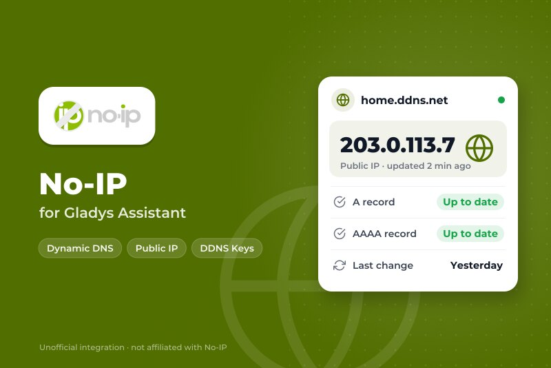
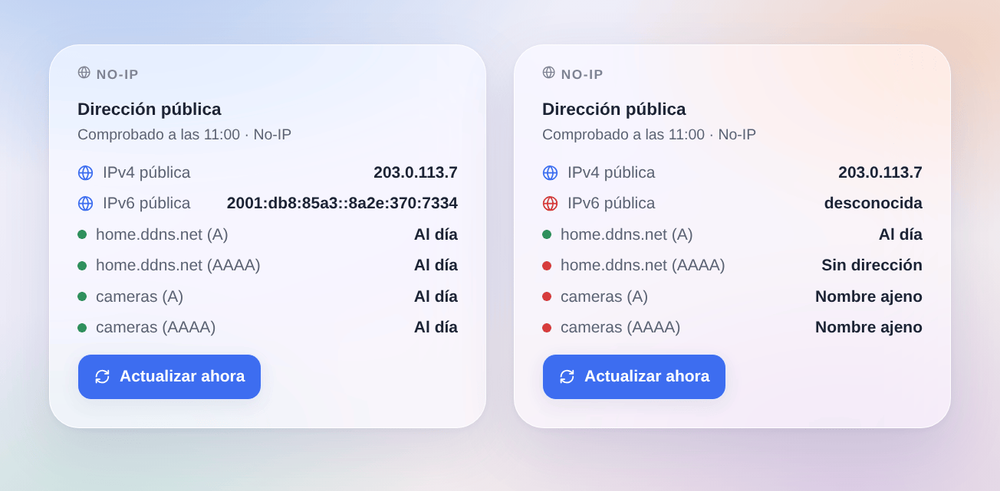
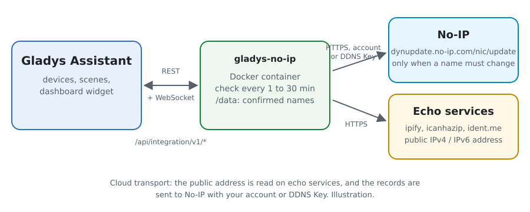
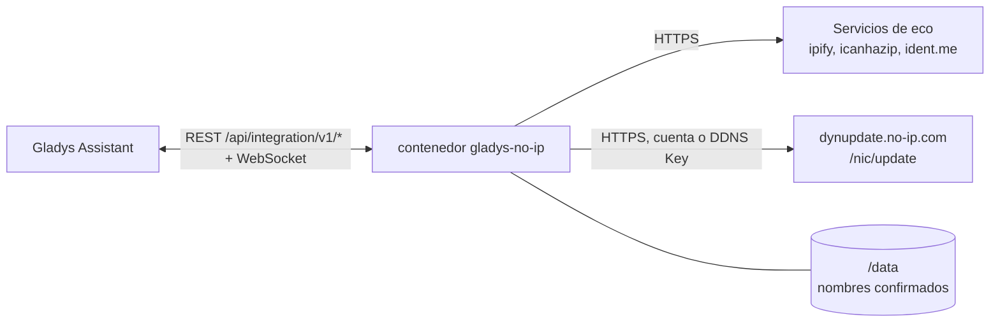
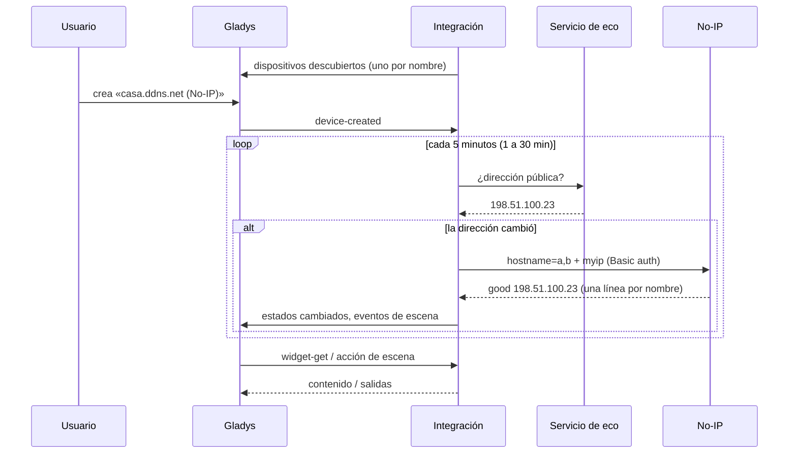

# Gladys No-IP

[English](README.md) · [Français](README.fr.md) · [Deutsch](README.de.md) · **Español**

[](LICENSE)
[](https://github.com/William-De71/gladys-no-ip/releases)
[](https://github.com/William-De71/gladys-no-ip/actions/workflows/release.yml)
[](https://gladysassistant.com)



Integración externa de [Gladys Assistant](https://gladysassistant.com) de **DNS dinámico con [No-IP](https://www.noip.com)**: Gladys mantiene tus nombres de host No-IP (`casa.ddns.net`), grupos o DDNS Keys apuntando a la dirección pública IPv4 / IPv6 de tu casa, mediante el punto de acceso oficial de actualización de No-IP. Cada nombre se convierte en un dispositivo, y las escenas pueden reaccionar cuando cambia la dirección pública o falla una actualización.

Documentación de usuario: [English](docs/en.md) · [Français](docs/fr.md) · [Deutsch](docs/de.md) · [Español](docs/es.md).

> Integración comunitaria, sin relación con No-IP ni respaldada por No-IP.

## Funciones

- **Hasta diez nombres** en un solo campo: nombres de host, grupos de No-IP, o `all.ddnskey.com` para todos los nombres de una DDNS Key; IPv4 (A), IPv6 (AAAA) o ambas, enviadas juntas en una petición.
- **Un dispositivo por nombre**: direcciones IPv4 e IPv6 confirmadas por No-IP, estado en palabras, número de cambios de dirección.
- **3 disparadores de escena**: dirección pública cambiada, registro actualizado, fallo de actualización (una vez por error).
- **2 acciones de escena**: actualizar ahora (un nombre o todos, opcionalmente forzado), leer la dirección pública.
- **1 widget del panel**: la dirección pública y cada nombre con su estado, y un botón **Actualizar ahora**.
- **Botones de configuración**: probar la conexión (cada nombre enviado al momento), diagnóstico.
- Sigue las reglas de cliente de No-IP: un nombre solo se envía si su dirección debe cambiar, nunca dos peticiones en el mismo minuto, cualquier error detiene las actualizaciones hasta un cambio de configuración (incluso tras un reinicio), y no se envía nada durante 30 minutos tras una avería de No-IP. Cuatro idiomas (inglés, francés, alemán, español).



## Funcionamiento





En cada comprobación (cada 5 minutos por defecto), la integración lee la dirección pública en servicios de eco (el siguiente si uno falla) y la compara con la dirección que No-IP confirmó por última vez para cada nombre, guardada en `/data`. En la primerísima comprobación, un nombre de host que ya apunta a la dirección pública se adopta sin llamada (los grupos y las DDNS Keys no son nombres DNS: se envían una vez). Los nombres que deben cambiar van en una sola petición a `https://dynupdate.no-ip.com/nic/update` (`hostname=a,b&myip=<ipv4>,<ipv6>`); No-IP responde una línea por nombre (`good` = cambiado, `nochg` = ya al día, o un error). Un nombre de host que sigue apuntando a otro sitio un cuarto de hora después de una actualización se vuelve a enviar, como máximo cada 6 horas: No-IP bloquea a los clientes que acumulan `nochg`.



### Transporte

Solo cloud (`"transports": ["cloud"]`): el catálogo muestra el distintivo cloud, y no hay botón «preferir la conexión local». La integración contacta con los servicios de eco `api.ipify.org`, `ipv4.icanhazip.com`, `v4.ident.me` (y sus gemelos IPv6 cuando se sigue el IPv6), que solo ven la dirección de tu casa, y con `dynupdate.no-ip.com` con tu acceso. La contraseña se queda en Gladys y en el contenedor; el botón **Diagnóstico** solo muestra su longitud.

## Dispositivos y funciones

| Dispositivo        | Función                        | Categoría / tipo           | Rango          |
| ------------------ | ------------------------------ | -------------------------- | -------------- |
| `<nombre>` (No-IP) | Dirección IPv4 (registro A)    | `text` / text              | —              |
| `<nombre>` (No-IP) | Dirección IPv6 (registro AAAA) | `text` / text              | —              |
| `<nombre>` (No-IP) | Estado de No-IP                | `text` / text              | —              |
| `<nombre>` (No-IP) | Cambios de dirección           | `counter-sensor` / integer | 0 – 10 000 000 |

Id externo: `host:<nombre>`, el nombre de host, el grupo o `all.ddnskey.com` en minúsculas, sea cual sea su lugar en la lista. Las funciones IPv4 / IPv6 solo existen si se sigue esa familia. `should_poll` es false: la integración comprueba con su propio temporizador.

## Disparadores, acciones de escena y widgets

| Tipo       | Clave               | Uso                                                                                         |
| ---------- | ------------------- | ------------------------------------------------------------------------------------------- |
| Disparador | `public_ip_changed` | La dirección pública cambió; filtro: IPv4 / IPv6.                                           |
| Disparador | `record_updated`    | No-IP apuntó un nombre a una nueva dirección; filtros: dispositivo del nombre, IPv4 / IPv6. |
| Disparador | `update_failed`     | Un nombre no se pudo actualizar, una vez por error; filtros: dispositivo del nombre, error. |
| Acción     | `update_now`        | Comprobar y actualizar ahora; un nombre o todos, opcionalmente forzado (una vez por hora).  |
| Acción     | `get_public_ip`     | La IPv4 y la IPv6 públicas, y una frase.                                                    |
| Widget     | `status`            | Dirección pública, cada nombre con su estado, **Actualizar ahora**.                         |

Las variables de los disparadores dan el nombre, el tipo de dirección, la dirección nueva y la anterior, y para un fallo el código y el mensaje de error. La primera comprobación es una referencia: la dirección pública vista al instalar no dispara nada, y un reinicio nunca dispara dos veces el mismo cambio. Una acción de escena nunca lanza un disparador (sin bucles) ni levanta una parada; un cambio que vio se dispara en la siguiente comprobación.

Ejemplos:

- «Dirección pública cambiada» → enviar «Nueva dirección: {{triggerEvent.data.ip}}» a tu teléfono.
- «Fallo de actualización», error «acceso rechazado» → recordarte revisar la DDNS Key.
- Cada mañana → «leer la dirección pública» → escribirla en un mensaje.

## Requisitos

- Gladys Assistant **5.3.0** o posterior (widgets, disparadores y acciones de escena de las integraciones externas, palabras clave del catálogo de Gladys 5.3). Las instancias más antiguas no pueden instalar la integración.
- Una cuenta No-IP con al menos un nombre de host, idealmente una **DDNS Key** (Dynamic DNS → DDNS Keys). Los nombres gratuitos se siguen confirmando en la web de No-IP cada 30 días.

## Instalación

- **Desde la tienda** de Gladys (Integraciones → Integraciones externas), en un clic, una vez indexada.
- **Desde la URL del repositorio**: `https://github.com/William-De71/gladys-no-ip`.
- **Modo desarrollador**: construye la imagen en local (`docker build -t gladys-no-ip .`) e instálala desde Gladys.

## Configuración

| Campo                                | Descripción                                                                                      |
| ------------------------------------ | ------------------------------------------------------------------------------------------------ |
| Usuario                              | El usuario de una DDNS Key, o el correo electrónico (o el usuario) de la cuenta No-IP.           |
| Contraseña                           | Su contraseña (secreta).                                                                         |
| Nombres de host                      | Separados por comas, diez como máximo: nombres de host, grupos, `all.ddnskey.com` con una clave. |
| Registros que actualizar             | IPv4 (A, por defecto), IPv6 (AAAA), o ambos.                                                     |
| Comprobación de la dirección pública | Cada minuto, 5 minutos (por defecto), 15 o 30 minutos.                                           |
| Idioma de los textos                 | Nombres de dispositivos, estado y resúmenes de escena. Automático sigue el panel.                |

Botones: **Probar la conexión** (envía al momento cada nombre a No-IP, levanta una parada y muestra la respuesta por nombre) y **Diagnóstico** (escribe la configuración, las direcciones públicas, los nombres confirmados y los últimos errores en la pestaña Registros, contraseña oculta).

## Uso

1. Crea una DDNS Key en la web de No-IP (o usa tu cuenta), introduce su usuario, su contraseña y tus nombres de host, guarda y pulsa **Probar la conexión**.
2. En la pestaña **Descubrir**, crea el dispositivo de cada nombre.
3. Añade el widget **No-IP** a un panel, y crea escenas con los disparadores y acciones de arriba.

## Desarrollo

```bash
npm install
npm test                       # node --test, nunca toca la red
npm run lint && npm run format:check
npx github:GladysAssistant/integration-store . --skip-image-check
scripts/build-cover.sh         # cover.jpg desde docs/assets/cover.svg
docs/illustrations/render.sh   # docs/assets/widgets.<lang>.png
node .github/scripts/release.mjs next
```

En local, el SDK lee `GLADYS_HOST_API_URL`, `GLADYS_INTEGRATION_TOKEN` y `GLADYS_INTEGRATION_SELECTOR`; `DEBUG=gladys-integration-sdk` muestra los registros del SDK y comprueba cada contenido de widget. Las pruebas usan una red falsa que responde como No-IP (una línea por nombre, `good`, `nochg`, `nohost`, `badauth` con HTTP 401, `911`, `abuse`…) y un resolvedor falso. Las reglas del proyecto están en [CLAUDE.md](CLAUDE.md).

## Proceso de publicación


Cada fusión en `main` lanza la CI y luego calcula la versión a partir de los [Conventional Commits](https://www.conventionalcommits.org/) desde la última etiqueta: `feat` → menor, `fix` / `perf` → parche, `!` o `BREAKING CHANGE` → mayor (una menor por debajo de 1.0.0); `docs`, `chore`, `ci`, `test`, `style`, `refactor`, `build` solos no publican nada. Se genera la sección del changelog, se sube la etiqueta, se construye la imagen multiarquitectura, luego `main` recibe el commit de publicación, se crea la GitHub Release y un último job comprueba la imagen pública, el validador de la tienda y el topic.

- El título de la pull request se convierte en el commit squash y luego en la línea del changelog: escríbelo en inglés, para el usuario (`pr-title.yml` lo comprueba). No edites nunca `CHANGELOG.md` a mano.
- La 1.0.0 es una decisión: Actions → Release → Run workflow con `release-as: 1.0.0`. `dry-run` muestra la versión y las notas sin publicar.
- **Rama protegida**: la publicación sube su commit a `main` con `GITHUB_TOKEN`. Con un ruleset en `main` más estricto que «ni borrado ni force-push», añade GitHub Actions a su lista de omisión (o sube mediante una GitHub App); si no, el job de publicación falla con instrucciones.
- Tras la primera publicación, haz público el paquete `ghcr.io` (Package settings → Change visibility); si no, Gladys no puede descargarlo.

## Solución de problemas

Consulta [docs/es.md](docs/es.md#solución-de-problemas). Informa de los problemas con las versiones de Gladys y de la integración, el nombre y el tipo de dirección afectados, y las líneas del botón **Diagnóstico**, nunca una contraseña.

## Contribuir

Las issues y pull requests son bienvenidas. Ejecuta `npm run format:check && npm run lint && npm test` antes de abrir una pull request, y mantén sin cambios todos los ids externos y claves guardadas (ver [CLAUDE.md](CLAUDE.md)).

## Seguridad

Consulta [SECURITY.md](SECURITY.md): informa de las vulnerabilidades en privado. La contraseña es un campo `secret`: nunca se registra, nunca se envía a otro sitio que `dynupdate.no-ip.com`, nunca se escribe en `/data`. La integración se ejecuta en solo lectura, como usuario no root, en su contenedor.

## Capturas por venir

Las imágenes de arriba son ilustraciones, no capturas de pantalla. Las capturas reales irán en `docs/assets/screenshots/` (PNG, 1280 × 800): `configuration.png`, `discovery.png`, `device.png`, `scene.png`.

## Licencia

[Licencia Apache 2.0](LICENSE), ver también [NOTICE](NOTICE). Los nombres se actualizan mediante el [punto de acceso de actualización de No-IP](https://www.noip.com/integrate/request); la dirección pública se lee en [ipify](https://www.ipify.org), [icanhazip](https://icanhazip.com) y [ident.me](https://ident.me). No-IP es una marca de Vitalwerks Internet Solutions, LLC. Gracias a la documentación y al SDK de Gladys.
