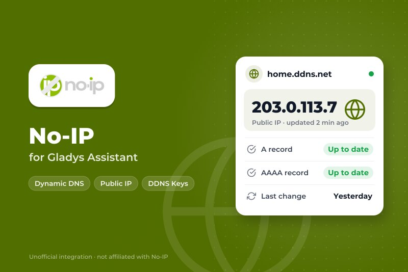
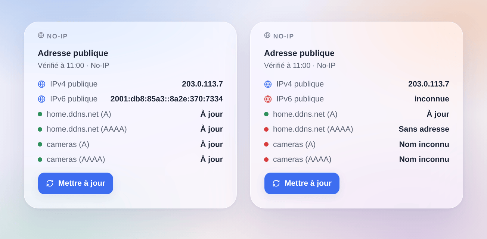
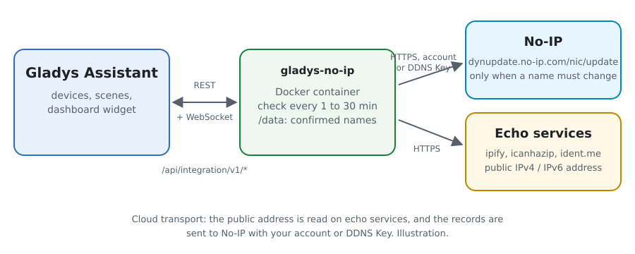
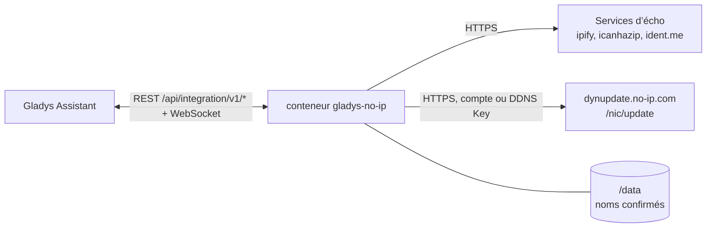
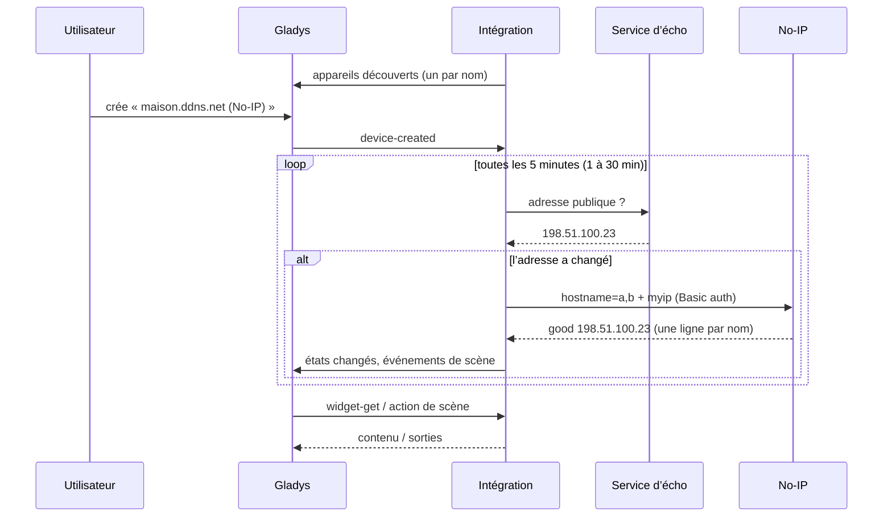

# Gladys No-IP

[English](README.md) · **Français** · [Deutsch](README.de.md) · [Español](README.es.md)

[](LICENSE)
[](https://github.com/William-De71/gladys-no-ip/releases)
[](https://github.com/William-De71/gladys-no-ip/actions/workflows/release.yml)
[](https://gladysassistant.com)



Intégration externe de [Gladys Assistant](https://gladysassistant.com) pour le **DNS dynamique avec [No-IP](https://www.noip.com)** : Gladys garde vos noms d’hôte No-IP (`maison.ddns.net`), groupes ou DDNS Keys pointés vers l’adresse IPv4 / IPv6 publique de votre maison, par le point d’accès officiel de mise à jour de No-IP. Chaque nom devient un appareil, et des scènes peuvent réagir quand l’adresse publique change ou qu’une mise à jour échoue.

Documentation utilisateur : [English](docs/en.md) · [Français](docs/fr.md) · [Deutsch](docs/de.md) · [Español](docs/es.md).

> Intégration communautaire, sans lien avec No-IP ni approuvée par No-IP.

## Fonctionnalités

- **Jusqu’à dix noms** dans un seul champ : noms d’hôte, groupes No-IP, ou `all.ddnskey.com` pour tous les noms d’une DDNS Key ; IPv4 (A), IPv6 (AAAA) ou les deux, envoyées ensemble en une requête.
- **Un appareil par nom** : adresses IPv4 et IPv6 confirmées par No-IP, état en clair, nombre de changements d’adresse.
- **3 déclencheurs de scène** : adresse publique changée, enregistrement mis à jour, échec de mise à jour (une fois par erreur).
- **2 actions de scène** : mettre à jour (un nom ou tous, éventuellement forcé), lire l’adresse publique.
- **1 widget de tableau de bord** : l’adresse publique et chaque nom avec son état, et un bouton **Mettre à jour**.
- **Boutons de configuration** : tester la connexion (chaque nom envoyé tout de suite), diagnostic.
- Suit les règles client de No-IP : un nom n’est envoyé que si son adresse doit changer, jamais deux requêtes dans la même minute, toute erreur arrête les mises à jour jusqu’à un changement de configuration (même après un redémarrage), et rien n’est envoyé pendant 30 minutes après une panne No-IP. Quatre langues (anglais, français, allemand, espagnol).



## Fonctionnement





À chaque vérification (toutes les 5 minutes par défaut), l’intégration lit l’adresse publique sur des services d’écho (le suivant si l’un échoue) et la compare à l’adresse que No-IP a confirmée en dernier pour chaque nom, gardée dans `/data`. À la toute première vérification, un nom d’hôte qui pointe déjà vers l’adresse publique est adopté sans appel (les groupes et les DDNS Keys ne sont pas des noms DNS : ils sont envoyés une fois). Les noms qui doivent changer partent en une seule requête vers `https://dynupdate.no-ip.com/nic/update` (`hostname=a,b&myip=<ipv4>,<ipv6>`) ; No-IP répond une ligne par nom (`good` = changé, `nochg` = déjà à jour, ou une erreur). Un nom d’hôte qui pointe encore ailleurs un quart d’heure après une mise à jour est renvoyé, au plus toutes les 6 heures : No-IP bloque les clients qui accumulent les `nochg`.



### Transport

Cloud uniquement (`"transports": ["cloud"]`) : le catalogue affiche le badge cloud, et il n’y a pas de bouton « préférer la connexion locale ». L’intégration contacte les services d’écho `api.ipify.org`, `ipv4.icanhazip.com`, `v4.ident.me` (et leurs jumeaux IPv6 quand l’IPv6 est suivie), qui ne voient que l’adresse de votre maison, et `dynupdate.no-ip.com` avec votre identifiant. Le mot de passe reste dans Gladys et dans le conteneur ; le bouton **Diagnostic** n’en montre que la longueur.

## Appareils et fonctionnalités

| Appareil        | Fonctionnalité                     | Catégorie / type           | Plage          |
| --------------- | ---------------------------------- | -------------------------- | -------------- |
| `<nom>` (No-IP) | Adresse IPv4 (enregistrement A)    | `text` / text              | —              |
| `<nom>` (No-IP) | Adresse IPv6 (enregistrement AAAA) | `text` / text              | —              |
| `<nom>` (No-IP) | État No-IP                         | `text` / text              | —              |
| `<nom>` (No-IP) | Changements d’adresse              | `counter-sensor` / integer | 0 – 10 000 000 |

Identifiant externe : `host:<nom>`, le nom d’hôte, le groupe ou `all.ddnskey.com` en minuscules, quelle que soit sa place dans la liste. Les fonctionnalités IPv4 / IPv6 n’existent que si cette famille est suivie. `should_poll` vaut false : l’intégration vérifie avec son propre minuteur.

## Déclencheurs, actions de scène et widgets

| Type        | Clé                 | Usage                                                                                       |
| ----------- | ------------------- | ------------------------------------------------------------------------------------------- |
| Déclencheur | `public_ip_changed` | L’adresse publique a changé ; filtre : IPv4 / IPv6.                                         |
| Déclencheur | `record_updated`    | No-IP a pointé un nom vers une nouvelle adresse ; filtres : appareil du nom, IPv4 / IPv6.   |
| Déclencheur | `update_failed`     | Un nom n’a pas pu être mis à jour, une fois par erreur ; filtres : appareil du nom, erreur. |
| Action      | `update_now`        | Vérifier et mettre à jour ; un nom ou tous, éventuellement forcé (une fois par heure).      |
| Action      | `get_public_ip`     | L’IPv4 et l’IPv6 publiques, et une phrase.                                                  |
| Widget      | `status`            | Adresse publique, chaque nom avec son état, **Mettre à jour**.                              |

Les variables des déclencheurs donnent le nom, le type d’adresse, la nouvelle et l’ancienne adresse, et pour un échec le code et le message d’erreur. La première vérification sert de référence : l’adresse publique vue à l’installation ne déclenche rien, et un redémarrage ne déclenche jamais deux fois le même changement. Une action de scène ne lance jamais de déclencheur (pas de boucle) et ne lève jamais un arrêt ; un changement qu’elle a vu se déclenche à la vérification suivante.

Exemples :

- « Adresse publique changée » → envoyer « Nouvelle adresse : {{triggerEvent.data.ip}} » sur votre téléphone.
- « Échec de mise à jour », erreur « identifiant refusé » → vous rappeler de vérifier la DDNS Key.
- Chaque matin → « lire l’adresse publique » → l’écrire dans un message.

## Prérequis

- Gladys Assistant **5.3.0** ou plus récent (widgets, déclencheurs et actions de scène des intégrations externes, mots-clés du catalogue de Gladys 5.3). Les instances plus anciennes ne peuvent pas installer l’intégration.
- Un compte No-IP avec au moins un nom d’hôte, idéalement une **DDNS Key** (Dynamic DNS → DDNS Keys). Les noms gratuits doivent toujours être confirmés sur le site No-IP tous les 30 jours.

## Installation

- **Depuis le store** de Gladys (Intégrations → Intégrations externes), en un clic, une fois indexée.
- **Depuis l’URL du dépôt** : `https://github.com/William-De71/gladys-no-ip`.
- **Mode développeur** : construisez l’image localement (`docker build -t gladys-no-ip .`) et installez-la depuis Gladys.

## Configuration

| Champ                              | Description                                                                                   |
| ---------------------------------- | --------------------------------------------------------------------------------------------- |
| Identifiant                        | L’identifiant d’une DDNS Key, ou l’adresse e-mail (ou l’identifiant) du compte No-IP.         |
| Mot de passe                       | Son mot de passe (secret).                                                                    |
| Noms d’hôte                        | Séparés par des virgules, dix au plus : noms d’hôte, groupes, `all.ddnskey.com` avec une clé. |
| Enregistrements à mettre à jour    | IPv4 (A, par défaut), IPv6 (AAAA), ou les deux.                                               |
| Vérification de l’adresse publique | Toutes les minutes, 5 minutes (par défaut), 15 ou 30 minutes.                                 |
| Langue des textes                  | Noms d’appareils, état et résumés de scène. Automatique suit le tableau de bord.              |

Boutons : **Tester la connexion** (envoie tout de suite chaque nom à No-IP, lève un arrêt, et affiche la réponse par nom) et **Diagnostic** (écrit la configuration, les adresses publiques, les noms confirmés et les dernières erreurs dans l’onglet Journaux, mot de passe masqué).

## Utilisation

1. Créez une DDNS Key sur le site No-IP (ou utilisez votre compte), saisissez son identifiant, son mot de passe et vos noms d’hôte, enregistrez et appuyez sur **Tester la connexion**.
2. Dans l’onglet **Découverte**, créez l’appareil de chaque nom.
3. Ajoutez le widget **No-IP** à un tableau de bord, et construisez des scènes avec les déclencheurs et actions ci-dessus.

## Développement

```bash
npm install
npm test                       # node --test, ne touche jamais le réseau
npm run lint && npm run format:check
npx github:GladysAssistant/integration-store . --skip-image-check
scripts/build-cover.sh         # cover.jpg depuis docs/assets/cover.svg
docs/illustrations/render.sh   # docs/assets/widgets.<lang>.png
node .github/scripts/release.mjs next
```

En local, le SDK lit `GLADYS_HOST_API_URL`, `GLADYS_INTEGRATION_TOKEN` et `GLADYS_INTEGRATION_SELECTOR` ; `DEBUG=gladys-integration-sdk` affiche les journaux du SDK et vérifie chaque contenu de widget. Les tests utilisent un faux réseau qui répond comme No-IP (une ligne par nom, `good`, `nochg`, `nohost`, `badauth` en HTTP 401, `911`, `abuse`…) et un faux résolveur. Les règles du projet sont dans [CLAUDE.md](CLAUDE.md).

## Processus de release


Chaque fusion sur `main` lance la CI, puis calcule la version à partir des [Conventional Commits](https://www.conventionalcommits.org/) depuis le dernier tag : `feat` → mineure, `fix` / `perf` → correctif, `!` ou `BREAKING CHANGE` → majeure (une mineure sous 1.0.0) ; `docs`, `chore`, `ci`, `test`, `style`, `refactor`, `build` seuls ne publient rien. La section du changelog est générée, le tag poussé, l’image multi-architecture construite, puis `main` reçoit le commit de release, la GitHub Release est créée et un dernier job vérifie l’image publique, le validateur du store et le topic.

- Le titre de la pull request devient le commit squash, puis la ligne du changelog : écrivez-le en anglais, pour l’utilisateur (`pr-title.yml` le vérifie). Ne modifiez jamais `CHANGELOG.md` à la main.
- La 1.0.0 est une décision : Actions → Release → Run workflow avec `release-as: 1.0.0`. `dry-run` affiche la version et les notes sans rien publier.
- **Branche protégée** : des rulesets imposent une pull request sur `main` et verrouillent les tags `v*` ; seuls le mainteneur et les deploy keys passent. La release pousse avec la deploy key de l’environnement `release` (secret `RELEASE_DEPLOY_KEY`, `main` seulement) : un run lancé depuis une autre branche ne l’obtient jamais. `build.yml` et `github-release.yml` ne démarrent pas sur un tag : la release les appelle, ou lancez-les à la main (Actions → Run workflow, avec `version` pour l’image) pour terminer une release.
- Après la première release, rendez public le package `ghcr.io` (Package settings → Change visibility), sinon Gladys ne peut pas le télécharger.

## Dépannage

Voir [docs/fr.md](docs/fr.md#dépannage). Signalez un problème avec les versions de Gladys et de l’intégration, le nom et le type d’adresse concernés, et les lignes du bouton **Diagnostic**, jamais un mot de passe.

## Contribuer

Issues et pull requests bienvenues. Lancez `npm run format:check && npm run lint && npm test` avant d’ouvrir une pull request, et gardez inchangés tous les identifiants externes et clés enregistrées (voir [CLAUDE.md](CLAUDE.md)).

## Sécurité

Voir [SECURITY.md](SECURITY.md) : signalez les vulnérabilités en privé. Le mot de passe est un champ `secret` : jamais écrit dans les journaux, jamais envoyé ailleurs qu’à `dynupdate.no-ip.com`, jamais écrit dans `/data`. L’intégration tourne en lecture seule, avec un utilisateur non root, dans son conteneur.

## Captures à venir

Les images ci-dessus sont des illustrations, pas des captures d’écran. Les vraies captures iront dans `docs/assets/screenshots/` (PNG, 1280 × 800) : `configuration.png`, `discovery.png`, `device.png`, `scene.png`.

## Licence

[Licence Apache 2.0](LICENSE), voir aussi [NOTICE](NOTICE). Les noms sont mis à jour par le [point d’accès de mise à jour de No-IP](https://www.noip.com/integrate/request) ; l’adresse publique est lue sur [ipify](https://www.ipify.org), [icanhazip](https://icanhazip.com) et [ident.me](https://ident.me). No-IP est une marque de Vitalwerks Internet Solutions, LLC. Merci à la documentation et au SDK de Gladys.
