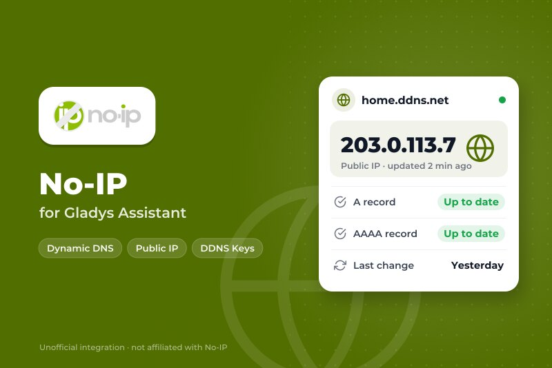
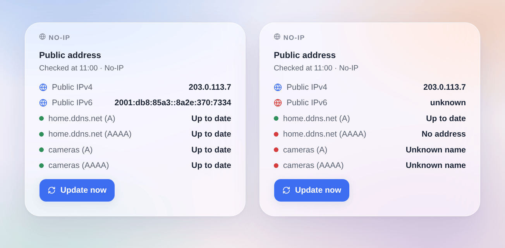
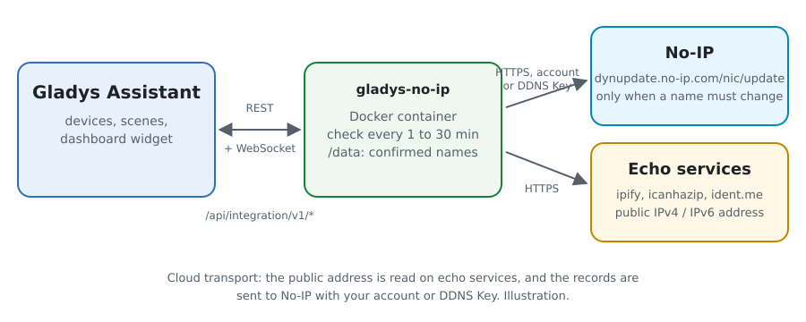
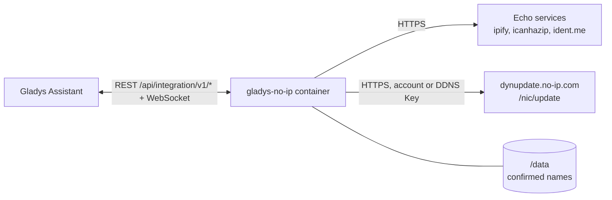
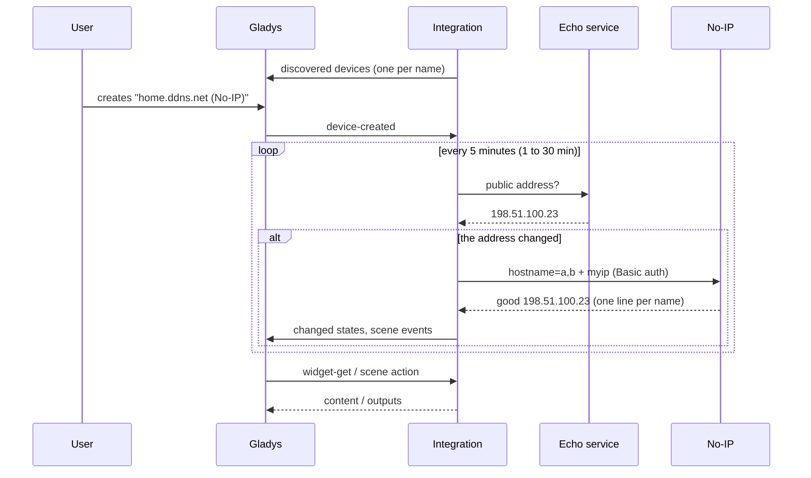

# Gladys No-IP

**English** · [Français](README.fr.md) · [Deutsch](README.de.md) · [Español](README.es.md)

[](LICENSE)
[](https://github.com/William-De71/gladys-no-ip/releases)
[](https://github.com/William-De71/gladys-no-ip/actions/workflows/release.yml)
[](https://gladysassistant.com)



[Gladys Assistant](https://gladysassistant.com) external integration for **dynamic DNS with [No-IP](https://www.noip.com)**: Gladys keeps your No-IP hostnames (`home.ddns.net`), groups or DDNS Keys pointed at the public IPv4 / IPv6 address of your home, through the official No-IP update endpoint. Each name becomes a device, and scenes can react when the public address changes or an update fails.

User documentation: [English](docs/en.md) · [Français](docs/fr.md) · [Deutsch](docs/de.md) · [Español](docs/es.md).

> Community integration, not affiliated with nor endorsed by No-IP.

## Features

- **Up to ten names** in one setting: hostnames, No-IP groups, or `all.ddnskey.com` for every hostname of a DDNS Key; IPv4 (A), IPv6 (AAAA) or both, sent together in one request.
- **One device per name**: IPv4 and IPv6 addresses confirmed by No-IP, status in words, number of address changes.
- **3 scene triggers**: public address changed, record updated, update failed (once per error).
- **2 scene actions**: update now (one name or all, optionally forced), read the public address.
- **1 dashboard widget**: the public address and every name with its status, and an **Update now** button.
- **Configuration buttons**: test the connection (every name sent at once), diagnostic.
- Follows the client rules of No-IP: a name is sent only when its address must change, never two requests within a minute, every error stops the updates until the settings change (even across a restart), and nothing is sent for 30 minutes after a No-IP failure. Four languages (English, French, German, Spanish).



## How it works





At each check (every 5 minutes by default), the integration reads the public address on echo services (the next one when one fails) and compares it with the address No-IP last confirmed for each name, kept in `/data`. On the very first check, a hostname that already resolves to the public address is adopted without a call (groups and DDNS Keys are no DNS names: they are sent once). The names that must change go in one request to `https://dynupdate.no-ip.com/nic/update` (`hostname=a,b&myip=<ipv4>,<ipv6>`); No-IP answers one line per name (`good` = changed, `nochg` = already right, or an error). A hostname still resolving elsewhere a quarter of an hour after an update is sent again, at most every 6 hours: No-IP blocks clients that collect too many `nochg`.



### Transport

Cloud only (`"transports": ["cloud"]`): the catalog shows the cloud badge, and there is no "prefer the local connection" button. The integration contacts the echo services `api.ipify.org`, `ipv4.icanhazip.com`, `v4.ident.me` (and their IPv6 twins when IPv6 is followed), which only see the address of your home, and `dynupdate.no-ip.com` with your login. The password stays in Gladys and in the container; the **Diagnostic** button only shows its length.

## Devices and features

| Device           | Feature                    | Category / type            | Range          |
| ---------------- | -------------------------- | -------------------------- | -------------- |
| `<name>` (No-IP) | IPv4 address (A record)    | `text` / text              | —              |
| `<name>` (No-IP) | IPv6 address (AAAA record) | `text` / text              | —              |
| `<name>` (No-IP) | No-IP status               | `text` / text              | —              |
| `<name>` (No-IP) | Address changes            | `counter-sensor` / integer | 0 – 10 000 000 |

External id: `host:<name>` — the hostname, group or `all.ddnskey.com` in lowercase, whatever its place in the list. The IPv4 / IPv6 features only exist when that family is followed. `should_poll` is false: the integration checks on its own timer.

## Scene triggers, actions and widgets

| Kind    | Key                 | Use                                                                       |
| ------- | ------------------- | ------------------------------------------------------------------------- |
| Trigger | `public_ip_changed` | The public address changed; filter: IPv4 / IPv6.                          |
| Trigger | `record_updated`    | No-IP pointed a name at a new address; filters: name device, IPv4 / IPv6. |
| Trigger | `update_failed`     | A name could not be updated, once per error; filters: name device, error. |
| Action  | `update_now`        | Check and update now; one name or all, optionally forced (once an hour).  |
| Action  | `get_public_ip`     | The public IPv4 and IPv6, and a sentence.                                 |
| Widget  | `status`            | Public address, every name with its status, **Update now**.               |

The trigger variables give the name, the address type, the new and former addresses, and for a failure the error code and message. The first check is a baseline: the public address seen at install fires nothing, and a restart never fires the same change twice. A scene action never fires a trigger (no loops) and never lifts a stop; a change it saw still fires at the next check.

Examples:

- "Public address changed" → send "New address: {{triggerEvent.data.ip}}" to your phone.
- "Update failed", error "login refused" → remind yourself to check the DDNS Key.
- Every morning → "read the public address" → write it in a message.

## Requirements

- Gladys Assistant **5.3.0** or later (widgets, scene triggers and actions of external integrations, catalog keywords of Gladys 5.3). Older instances cannot install the integration.
- A No-IP account with at least one hostname, ideally a **DDNS Key** (Dynamic DNS → DDNS Keys). Free hostnames must still be confirmed on the No-IP website every 30 days.

## Installation

- **From the store** of Gladys (Integrations → External integrations), in one click, once indexed.
- **From the repository URL**: `https://github.com/William-De71/gladys-no-ip`.
- **Developer mode**: build the image locally (`docker build -t gladys-no-ip .`) and install it from Gladys.

## Configuration

| Field                       | Description                                                                              |
| --------------------------- | ---------------------------------------------------------------------------------------- |
| Username                    | The username of a DDNS Key, or the e-mail address (or username) of the No-IP account.    |
| Password                    | Its password (secret).                                                                   |
| Hostnames                   | Comma-separated, ten at most: hostnames, group names, `all.ddnskey.com` with a DDNS Key. |
| Records to update           | IPv4 (A, default), IPv6 (AAAA), or both.                                                 |
| Check of the public address | Every minute, 5 minutes (default), 15 or 30 minutes.                                     |
| Language of the texts       | Device names, status and scene summaries. Automatic follows the dashboard.               |

Buttons: **Test the connection** (sends every name to No-IP now, lifts a stop, and shows the answer per name) and **Diagnostic** (writes the settings, the public addresses, the confirmed names and the last errors to the Logs tab, password hidden).

## Usage

1. Create a DDNS Key on the No-IP website (or use your account), enter its username, its password and your hostnames, save and press **Test the connection**.
2. In the **Discover** tab, create the device of each name.
3. Add the **No-IP** widget to a dashboard, and build scenes with the triggers and actions above.

## Development

```bash
npm install
npm test                       # node --test, never touches the network
npm run lint && npm run format:check
npx github:GladysAssistant/integration-store . --skip-image-check
scripts/build-cover.sh         # cover.jpg from docs/assets/cover.svg
docs/illustrations/render.sh   # docs/assets/widgets.<lang>.png
node .github/scripts/release.mjs next
```

Locally, the SDK reads `GLADYS_HOST_API_URL`, `GLADYS_INTEGRATION_TOKEN` and `GLADYS_INTEGRATION_SELECTOR`; `DEBUG=gladys-integration-sdk` shows the SDK logs and checks every widget content. The tests use a fake network that answers like No-IP (one line per name, `good`, `nochg`, `nohost`, `badauth` with HTTP 401, `911`, `abuse`…) and a fake resolver. The rules of the project are in [CLAUDE.md](CLAUDE.md).

## Release process


Every merge on `main` runs the CI, then computes the version from the [Conventional Commits](https://www.conventionalcommits.org/) since the last tag: `feat` → minor, `fix` / `perf` → patch, `!` or `BREAKING CHANGE` → major (a minor below 1.0.0); `docs`, `chore`, `ci`, `test`, `style`, `refactor`, `build` alone publish nothing. The changelog section is generated, the tag pushed, the multi-architecture image built, then `main` receives the release commit, the GitHub Release is created and a last job checks the public image, the store validator and the topic.

- The pull request title becomes the squash commit, then the changelog line: write it in English, for the user (`pr-title.yml` checks it). Never edit `CHANGELOG.md` by hand.
- 1.0.0 is a decision: Actions → Release → Run workflow with `release-as: 1.0.0`. `dry-run` shows the version and the notes without publishing.
- **Protected branch**: rulesets require a pull request on `main` and lock the `v*` tags; only the maintainer and deploy keys get through. The release pushes with the deploy key of the `release` environment (secret `RELEASE_DEPLOY_KEY`, `main` only): a run from another branch never gets it. `build.yml` and `github-release.yml` do not start on a tag: the release calls them, or run them by hand (Actions → Run workflow, with `version` for the image) to finish a release.
- After the first release, make the `ghcr.io` package public (Package settings → Change visibility), or Gladys cannot pull it.

## Troubleshooting

See [docs/en.md](docs/en.md#troubleshooting). Report issues with the versions of Gladys and of the integration, the name and the address type concerned, and the lines of the **Diagnostic** button — never a password.

## Contributing

Issues and pull requests are welcome. Run `npm run format:check && npm run lint && npm test` before opening a pull request, and keep every external id and stored key unchanged (see [CLAUDE.md](CLAUDE.md)).

## Security

See [SECURITY.md](SECURITY.md): report vulnerabilities privately. The password is a `secret` field: never logged, never sent anywhere but to `dynupdate.no-ip.com`, never written to `/data`. The integration runs read-only, as a non-root user, in its container.

## Screenshots to come

The images above are illustrations, not screenshots. Real screenshots will go in `docs/assets/screenshots/` (PNG, 1280 × 800): `configuration.png`, `discovery.png`, `device.png`, `scene.png`.

## License

[Apache License 2.0](LICENSE) — see also [NOTICE](NOTICE). The names are updated through the [update endpoint of No-IP](https://www.noip.com/integrate/request); the public address is read on [ipify](https://www.ipify.org), [icanhazip](https://icanhazip.com) and [ident.me](https://ident.me). No-IP is a trademark of Vitalwerks Internet Solutions, LLC. Thanks to the Gladys documentation and SDK.
