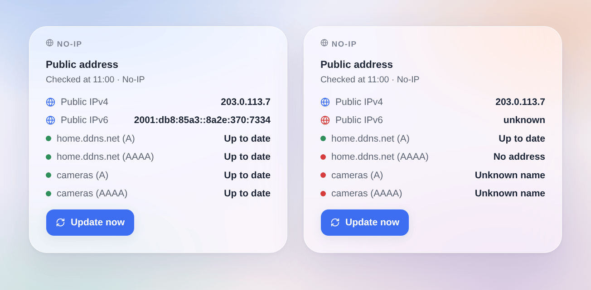

# No-IP

## Overview

This integration turns Gladys into the **dynamic DNS client** of your **No-IP** account. Your internet provider may change the public address of your home at any time; with No-IP, a hostname (`home.ddns.net`) always points at it, so you can reach your home, a NAS or a VPN by name. Gladys checks the public address every 5 minutes by default and asks No-IP to update your names only when it changed.

Up to **ten names**: hostnames, No-IP **groups**, or `all.ddnskey.com` for every hostname of a **DDNS Key**, following the **IPv4** address, the **IPv6** address or both. Each name becomes a device with its addresses, its status and the number of changes; scenes can react when the public address changes or an update fails, and a dashboard widget shows everything at a glance.

It uses the official update endpoint of No-IP, the same one routers and the No-IP client use, and follows its rules: one request for every name, nothing sent while the address is the same, and a stop after any error. It is a **cloud** integration: the public address is read on echo services (ipify, icanhazip, ident.me), and No-IP is contacted only when a name must change.

## Prerequisites

- Gladys Assistant 5.3.0 or later.
- A No-IP account (free or paid) with at least one hostname (No-IP website → **Dynamic DNS** → **No-IP Hostnames**).
- Recommended: a **DDNS Key** (**Dynamic DNS** → **DDNS Keys** → **Generate DDNS Key**). It only updates its hostnames, so your account password never goes into Gladys. Note its username and password: the password is shown only once.
- **Free hostnames** must still be confirmed on the No-IP website every 30 days (No-IP sends an e-mail): the integration cannot do it for you.
- For IPv6, a hostname with an AAAA record (or IPv4 and IPv6) at No-IP, and an IPv6 connection reaching the Docker of Gladys.

## Configuration

| Field                       | What to enter                                                                                     |
| --------------------------- | ------------------------------------------------------------------------------------------------- |
| Username                    | The username of the DDNS Key, or the e-mail address (or username) of your No-IP account.          |
| Password                    | The password of the DDNS Key, or of your No-IP account.                                           |
| Hostnames                   | Separated by commas, ten at most: `home.ddns.net`, a group name, or `all.ddnskey.com` with a key. |
| Records to update           | IPv4 (A, default), IPv6 (AAAA), or both.                                                          |
| Check of the public address | Every minute, 5 minutes (default), 15 or 30 minutes.                                              |
| Language of the texts       | Device names, status and scene summaries. Automatic follows your dashboard.                       |

Press **Test the connection**: every name is sent to No-IP at once, and the answer shows, per name, "already 203.0.113.7" (the login works), the new address, or the error. **Diagnostic** writes what the integration knows to the Logs tab, password hidden.

## Usage

### Devices

In **Discover**, create one device per name:

| Feature                    | Content                                                                  |
| -------------------------- | ------------------------------------------------------------------------ |
| IPv4 address (A record)    | The address No-IP confirmed for the name.                                |
| IPv6 address (AAAA record) | The same for IPv6, when it is followed.                                  |
| No-IP status               | "Up to date", "Waiting for the first check" or the last error, in words. |
| Address changes            | The number of updates No-IP applied; its history shows when they were.   |

### Dashboard widget

**No-IP** shows the public IPv4 (and IPv6), then each name with its status, the time of the last check and an **Update now** button.

### Scenes

Triggers:

- **Public address changed**: with the former and the new address; filter: IPv4 or IPv6.
- **Record updated**: No-IP pointed a name at a new address; filters: name, IPv4 or IPv6.
- **Update failed**: once per error, not at every check; filters: name, error (login refused, unknown name, client disabled, account blocked, No-IP unreachable, public address unknown…).

Actions:

- **Update now**: one name or all; "send even if already right" sends a name at most once an hour (too many "already right" answers get a client blocked). Outputs the counts and a summary. It never fires a trigger.
- **Read the public address**: the public IPv4 and IPv6, to put in a message.

Examples:

- "Public address changed" → send "New address: {{triggerEvent.data.ip}}" to your phone.
- "Update failed", error "login refused" → notify yourself to check the DDNS Key.
- Every morning → "read the public address" → write it to a log or a message.

### Transport

Cloud only: the public address is read on `api.ipify.org`, `ipv4.icanhazip.com` and `v4.ident.me` (the next one when one fails; their IPv6 twins for IPv6), and the names are sent to `dynupdate.no-ip.com` over HTTPS with your login. Those services only see the address of your home. Nothing else leaves your network.

## Troubleshooting

- **The integration stopped after an error**: No-IP requires its clients to stop sending after any error answer. Fix the settings (or press **Test the connection** once the problem is fixed on the No-IP side): it tries again at once. A restart does not lift the stop.
- **Username or password refused**: with a DDNS Key, the username is the one No-IP generated (not your e-mail address); with your account, the e-mail address and the account password.
- **Name unknown to this account**: the hostname or group does not exist under this account or this DDNS Key; check its spelling, or use `all.ddnskey.com` with a key. The other names keep being updated.
- **No-IP error, retry in 30 min**: No-IP had a failure ("911"); its rules forbid a new request before 30 minutes, even from the test button.
- **Client disabled** or **Account blocked**: No-IP refused this client or this account; contact No-IP support.
- **Public IPv6 unknown**: the Docker of Gladys has no IPv6 access to the internet. Keep IPv4 only.
- **The name is right but disappears after a month**: a free hostname was not confirmed; confirm it on the No-IP website.
- To report a problem, give the versions of Gladys and of the integration and the lines of the **Diagnostic** button.
